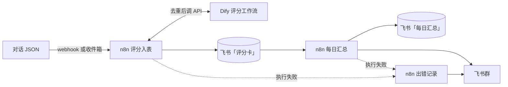

# 外贸回复质检：代码版与 Dify + n8n 版对照

给外贸业务员的 WhatsApp 回复打分。输入一段对话，输出一张评分卡：响应及时性、需求挖掘、议价与守底线、风险处理、专业度五项分数和总分，以及每条我方回复的评级；评级差的回复附一条能直接发给客户的示范说法和中文翻译。

同一套评分规则（提示词 `prompts/score-v5.txt`）做了两版，用同一个模型、同一批样本实测，比较直接写代码和用低代码平台在 token、延迟、结果一致性和开发量上的差别。评分内核取自原来的回复质检项目；样本是 8 段自编对话（`samples/conversations.json`），不含真实客户信息。

| | 代码版 | 平台版 |
|---|---|---|
| 评分 | `code-version/score.py`，单个 Python 文件，只用标准库 | Dify 工作流 `dify/reply-qc-score.yml` |
| 脱敏、渲染、校验 | 同一文件里的函数 | Dify 代码节点；插件版换成 Dify 工具插件 `dify/plugin/` |
| 触发与外围 | 命令行批量，JSON 进、JSONL 出 | n8n：webhook 和定时触发、去重、调 Dify、写飞书多维表格、每日汇总、出错提醒 |

## 平台版的结构



Dify 只管评一段对话：渲染与脱敏 → 判断有没有我方回复 → 评分 → 校验与钳制。没有我方回复或输入不合法时走跳过分支，不调模型；评分节点出错重试 2 次，仍失败走异常分支；「校验与钳制」把越界的分数钳回范围，丢掉模型多造的回复编号，超长文本截到句末。三条分支每次只走一条，最后汇成同一种输出。

n8n 的三个业务工作流：

- 评分入表：webhook 随时推送，或每 30 分钟读一次收件箱目录；按对话内容去重，调 Dify 评分，写进飞书「评分卡」后才记为已处理。单条失败记进错误表，下次触发自动重试。
- 每日汇总：每天 18:07 统计当天的评分卡，写进飞书「每日汇总」，存一份 Markdown，推送到飞书群。
- 出错记录：前两个工作流执行失败时记表，并推送到群。

## 实测结论

环境：2026-11-10，本机 Docker 自部署 Dify 1.19.0；模型 deepseek-flash，关闭思考，temperature 0.4，JSON 模式。

- token：两版每次评分都约 2570 token。3 轮共 24 次评分，状态分布相同：21 次打分，3 次因为没有我方回复而跳过。
- 延迟：端到端中位数代码版 2453 ms、Dify 版 2174 ms，差距在模型接口自身的波动范围内。不调模型的那段对话，在 Dify 里从请求到返回 0.2～0.3 秒。
- 一致性：脱敏、渲染、校验三个不调模型的步骤，34 个用例在代码版、Dify 代码节点、Dify 插件上各跑一遍，共 102 个测试，结果相同。
- 开发量：触发、去重、重试和出错流程，n8n 都有现成节点，3 个业务工作流共 36 个节点；数据整形仍要写代码，7 个 Code 节点共 137 行 JS。飞书接口的业务报错可能是 HTTP 200 加非 0 的 `code`，HTTP 节点不会当成失败，所以每个写飞书的节点后面都加了一步检查。

测量过程中查清的两个问题：

- Dify 版最初每次 3120 token，比代码版多约 550。原因是 Dify 的 DeepSeek 插件不支持原生结构化输出，平台改为把 schema 注入提示词。换成 JSON 模式、长度上限交给校验节点之后，两版持平。
- 最初测到 Dify 每次多约 2 秒，查明是这台 Windows 上 `localhost` 先解析到 IPv6 的 `::1`，而 Dify 的端口只绑在 IPv4，连接被拒后约 2 秒才退回 127.0.0.1。改用 127.0.0.1 后差距消失；受影响的数据和复测方法写在 docs/comparison.md。

完整数据见 [docs/comparison.md](docs/comparison.md)，n8n 的部署、运维和已知问题见 [docs/n8n.md](docs/n8n.md)。

## Dify 插件 reply_qc

用官方 `dify_plugin` SDK 把三个不调模型的步骤做成工具插件（`dify/plugin/`），提供「脱敏」「渲染与脱敏」「校验与钳制」三个工具。插件版工作流 `dify/reply-qc-score-plugin.yml` 用其中两个工具节点替换了原来的两个代码节点，其余节点不变。安装包见 [Release reply_qc-v0.0.1](https://github.com/Winkless213/reply-qc-workflows/releases/tag/reply_qc-v0.0.1)。

在本地 Dify 1.19.0 上的验证：

- 插件版工作流把 8 段样本跑了四轮（`out/dify-plugin-run1.jsonl` 到 `run4`）。第一轮插件走远程调试，后三轮装的是正式包。每轮都是 7 段打分、c07 跳过，和代码版一致。
- 打了分的每一段，评分卡都和代码版用同一份模型输出算出的结果逐字段相同，超长示范回复的截断位置也相同。
- c07 不调模型，工作流耗时中位数插件版 165 ms（4 次）、代码节点版 218 ms（9 次）。次数少，只能说明插件不比代码节点慢。

## 截图

Dify「回复质检评分」工作流：


n8n「评分入表」：webhook 和定时两个入口，单条失败走错误输出，写进飞书成功后才记为已处理。


n8n「每日汇总」和「出错记录」：


飞书多维表格「评分卡」：n8n 每评完一段对话写一行。c07 没有我方回复，不调模型，状态记为「无我方回复」。右侧还有专业度、差评条数、最该改的一条和建议说法几列，图里没截。


飞书群「回复质检」里的每日汇总和出错提醒，由应用机器人推送。出错提醒是往收件箱里放了一个写了一半的 JSON 触发的；前两条汇总发在清空测试数据、重跑之前。


## 目录

```
code-version/  代码版评分，评分内核取自原来的回复质检项目
dify/          Dify 工作流导出（DSL）和批量调用脚本
dify/plugin/   Dify 工具插件 reply_qc：脱敏、渲染、校验三个工具
n8n/           n8n 工作流；__FEISHU_*__ 等占位符由部署脚本从 .env 填入
prompts/       评分提示词 score-v5
samples/       8 段自编对话；first-run.txt 是在 Dify 画布上手动试跑用的输入
tests/         对照测试：确定性步骤在代码版、Dify 代码节点和插件里结果一致
tools/         对比汇总、Dify 开销探测、飞书配置、n8n 部署
out/           实测原始数据，每个 JSONL 文件是一轮
docs/          对比结论、n8n 部署运维、截图
infra/n8n/     n8n 的 docker compose
```

## 运行

需要 Python 3.12 和 Docker。代码版和脚本只用标准库；跑测试另需 `pip install pytest pyyaml dify_plugin`。

1. 复制 `.env.example` 为 `.env`，填模型接口（默认 DeepSeek，OpenAI 兼容）。
2. 代码版：`python code-version/score.py samples/conversations.json out/code.jsonl`
3. Dify 版：用官方 docker compose 自部署 Dify 1.19.0；导入 `dify/reply-qc-score.yml`，按提示安装 DeepSeek 插件并在模型供应商里填 API key；发布后在「访问 API」创建密钥，填进 `.env` 的 `DIFY_API_KEY`，再运行 `python dify/run_batch.py samples/conversations.json out/dify.jsonl`。
4. 对比两版输出：`python tools/compare_runs.py code="out/code.jsonl" dify="out/dify.jsonl"`
5. 对照测试：`pytest tests`
6. n8n：按 [docs/n8n.md](docs/n8n.md) 部署。
7. 插件版：见下一节。

### 安装插件

1. 下载 [Release reply_qc-v0.0.1](https://github.com/Winkless213/reply-qc-workflows/releases/tag/reply_qc-v0.0.1) 里的 `reply_qc-0.0.1.difypkg`；或者从 langgenius/dify-plugin-daemon 的发布页下载 Dify 官方插件 CLI（`dify-plugin`），自己打包：`dify-plugin plugin package dify/plugin -o reply_qc.difypkg`。
2. 在 Dify「集成」页点「安装」→「本地集成包」，上传插件包。自部署的 Dify 默认只装签过名的插件：安装前在 `docker/.env` 里加一行 `FORCE_VERIFYING_SIGNATURE=false`，重启 plugin_daemon；装完可以删掉这行再重启，已装的插件照常运行。
3. 导入 `dify/reply-qc-score-plugin.yml`，发布，创建 API 密钥，用这个密钥作 `DIFY_API_KEY` 运行 `python dify/run_batch.py samples/conversations.json out/dify-plugin.jsonl`。
4. 改插件时可以不打包：复制 `dify/plugin/.env.example` 为 `dify/plugin/.env`，填上「集成」页左下角「调试」里给的地址和密钥，在 `dify/plugin` 下运行 `python -m main`，插件会以调试模式出现在 Dify 里。用了调试中插件的应用不能导出 DSL。

关于插件标识：DSL 的依赖里记的是插件包的标识，按包内文件的内容计算。用 0.6.15 版 CLI 从没改过的 `dify/plugin` 打出来的包，和 Release 里的逐字节相同；改过插件再打包，标识会变，导入 DSL 时可能提示缺少 reply_qc，但工具节点按插件名找插件，装好改过的包照样能跑。
