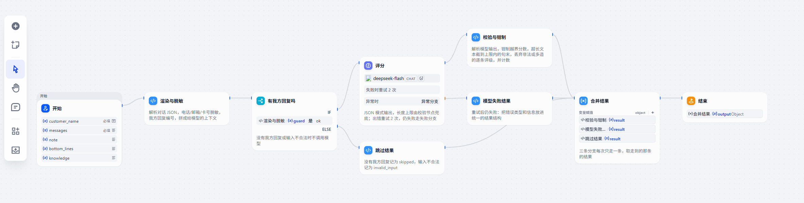
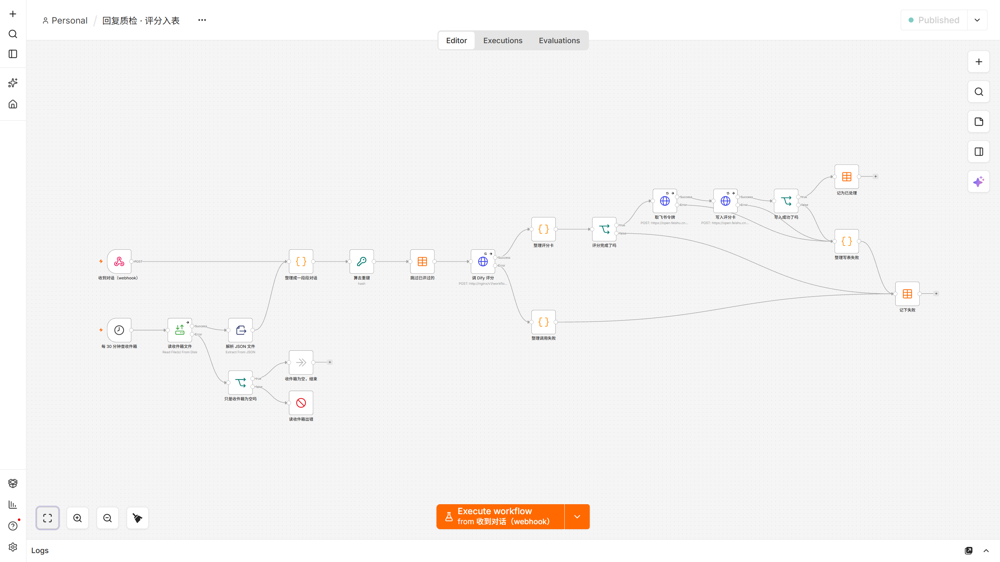
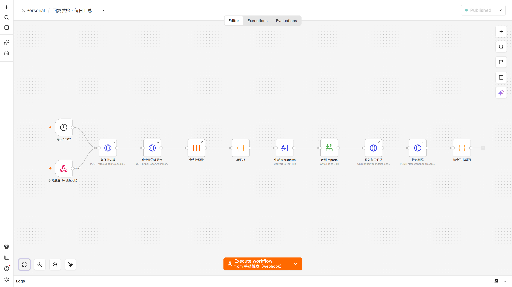
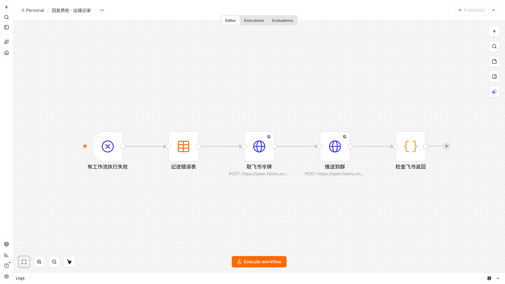
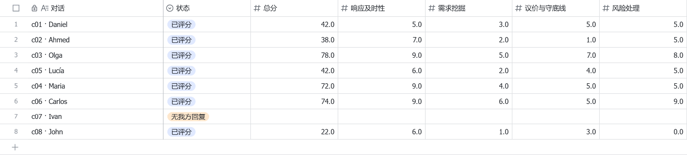
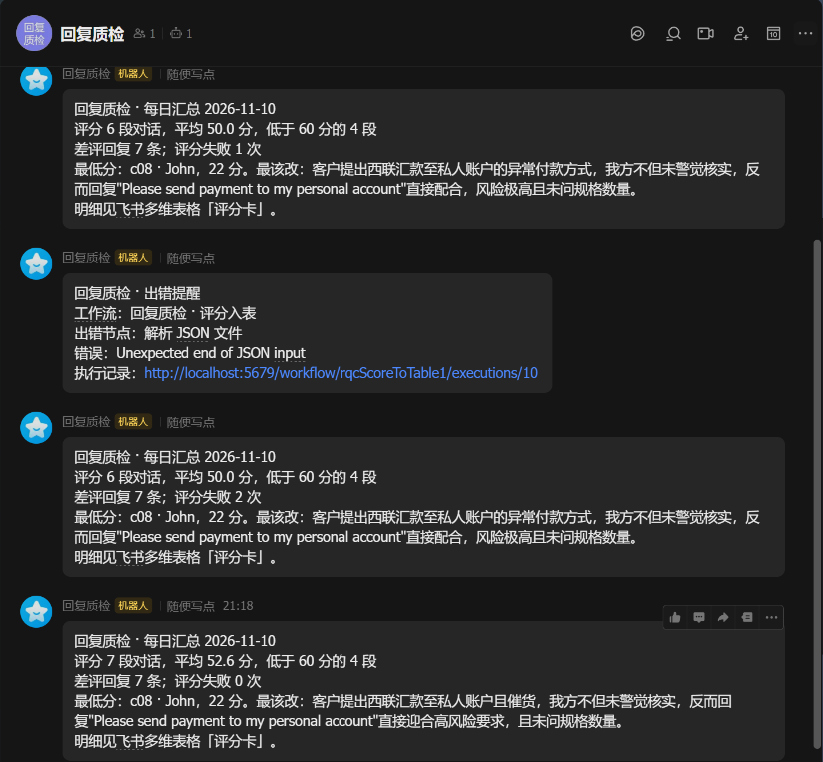

# 回复质检：同一件事，两种做法

给外贸业务员的客户回复打分。输入一段 WhatsApp 对话，输出一张评分卡：响应及时性、需求挖掘、议价与守底线、风险处理、专业度五个维度和总分，每条我方回复的评级；差的回复附一句能直接发给客户的示范说法和中文翻译。

同一套评分规则做了两遍，并实测对比：

| | 代码版 | 平台版 |
|---|---|---|
| 评分 | `code-version/score.py`，一个 Python 文件，只用标准库 | Dify 工作流 `dify/reply-qc-score.yml` |
| 外围 | 命令行批量：JSON 进，JSONL 出 | n8n：webhook 和定时触发、去重、调 Dify、写飞书多维表格、每日汇总、出错提醒 |

样本是 8 段自己编的对话（`samples/conversations.json`），不含真实客户信息。

## 结论

- 成本：同一模型、同一提示词，两版每次都约 2570 token；3 轮 24 次评分的状态分布一致。
- 延迟：两版的差距在模型接口自身的波动范围内；Dify 在工作流之外只多几十毫秒。先前测到的"Dify 每次多 2 秒"是 Windows 上 `localhost` 先走 IPv6 造成的，已更正。
- 一致性：脱敏、渲染、校验三个不调模型的步骤，68 个对照测试确认两版结果相同。
- n8n：触发、去重、重试、出错流程都有现成节点；数据整形仍要写代码（7 个 Code 节点共 137 行 JS），飞书接口的业务报错要自己判断。

数据和细节见 [docs/comparison.md](docs/comparison.md)，n8n 的部署和运维见 [docs/n8n.md](docs/n8n.md)。

## 截图

Dify「回复质检评分」工作流：先渲染与脱敏；没有我方回复或输入不合法就跳过，不调模型；评分节点出错重试 2 次，仍失败走异常分支；模型输出由「校验与钳制」兜底。三条分支每次只走一条，在「合并结果」汇成同一种输出。



n8n「评分入表」：webhook 和定时两个入口，单条失败走错误输出，写进飞书成功后才记为已处理。



n8n「每日汇总」和「出错记录」：





飞书多维表格「评分卡」：n8n 每评完一段对话写一行。c07 没有我方回复，不调模型，状态记为「无我方回复」。右边还有专业度、差评条数、最该改的一条和建议说法几列，图里没截。



飞书群「回复质检」收到的每日汇总和出错提醒，由应用机器人推送。出错提醒是往收件箱里放了一个写了一半的 JSON 触发的；前两条汇总发在清空测试数据、重跑之前。



## 目录

```
code-version/  代码版评分，评分内核取自原来的回复质检项目
dify/          Dify 工作流导出（DSL）和批量调用脚本
n8n/           n8n 工作流；__FEISHU_*__ 等占位符由部署脚本从 .env 填入
prompts/       评分提示词 score-v5
samples/       8 段自编对话；first-run.txt 是在 Dify 画布上手动试跑用的输入
tests/         对照测试：确定性步骤在代码版和 Dify 代码节点里结果一致
tools/         对比汇总、Dify 开销探测、飞书配置、n8n 部署
out/           实测原始数据，每个 JSONL 文件是一轮
docs/          对比结论、n8n 部署运维、截图
infra/n8n/     n8n 的 docker compose
```

## 运行

需要 Python 3.12 和 Docker。代码版和脚本只用标准库，测试另需 `pip install pytest pyyaml`。

1. 复制 `.env.example` 为 `.env`，填模型接口（默认 DeepSeek，OpenAI 兼容）。
2. 代码版：`python code-version/score.py samples/conversations.json out/code.jsonl`
3. Dify 版：
   1. 用官方 docker compose 自部署 Dify 1.19.0。
   2. 导入 `dify/reply-qc-score.yml`，按提示安装 DeepSeek 插件，在模型供应商里填 API key。
   3. 发布，在「访问 API」创建密钥，填进 `.env` 的 `DIFY_API_KEY`。
   4. `python dify/run_batch.py samples/conversations.json out/dify.jsonl`
4. 对比：`python tools/compare_runs.py code="out/code.jsonl" dify="out/dify.jsonl"`
5. 对照测试：`pytest tests`
6. n8n：按 [docs/n8n.md](docs/n8n.md) 部署。
